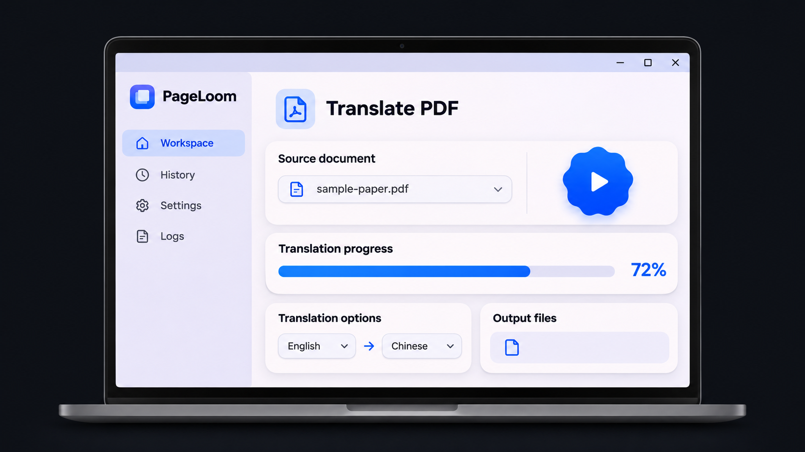

<strong>English</strong> · <a href="./README.zh-CN.md">简体中文</a>

<h1>PageLoom</h1>

Translate PDFs on Windows while preserving their layout, formulas, and figures.

<a href="./LICENSE">AGPL-3.0</a> · Windows x64 · Flutter

PageLoom (译页工坊) is a Windows desktop app built with Flutter. It uses PDFMathTranslate-next and BabelDOC to translate papers, technical manuals, and other PDFs where layout matters.

  
   
  Illustration of the desktop interface

## Features

- 📄 **Preserve document layout.** Keep formulas, figures, and tables in context, with monolingual and bilingual PDF output.
- 🌐 **Choose your translation service.** Use Bing, Google, an OpenAI-compatible endpoint, Ollama, or another supported service.
- 🎛️ **Control what gets translated.** Select page ranges, adjust PDF output and layout options, and import CSV glossaries or extract terms automatically.
- 📊 **Follow each job.** See live progress and engine logs, then reopen generated files from the local task history.

## Installation and Usage

### Installation

1. Download the **Windows x64 ZIP** from [Releases](https://github.com/XilinGuo/PageLoom/releases).
2. Extract the whole ZIP to a folder. Keep the executable and its companion files together when moving the app.
3. Double-click `PDFMathTranslate.exe`, the launcher name used by the current build.

The download includes the required runtimes, translation engine, layout models, and fonts. Online translation providers require a network connection. Some providers also require an API key or a separately running service.

### Usage

1. Open a PDF in the **Translation Workspace** (翻译工作台).
2. Choose the source language, target language, and PDF output mode.
3. Open **Translation Settings** (翻译设置) to change the service or configure glossaries and advanced options.
4. Click the blue play button. When translation finishes, open the PDF or its output folder from the workspace.

## Build from Source

See the [Windows packaging guide](./desktop/README.md#from-source) for prerequisites and the build command.

| Path | Purpose |
| --- | --- |
| [`desktop/lib/`](./desktop/lib/) | Flutter desktop interface |
| [`desktop/windows/`](./desktop/windows/) | Windows launcher and native integration |
| [`desktop/backend/bridge.py`](./desktop/backend/bridge.py) | Local Python bridge for translation progress and results |
| [`pdf2zh_next/`](./pdf2zh_next/) | PDFMathTranslate-next engine and Web UI |

## Acknowledgements and License

PageLoom builds on [PDFMathTranslate-next](https://github.com/PDFMathTranslate-next/PDFMathTranslate-next) and [BabelDOC](https://github.com/funstory-ai/BabelDOC). The desktop interface is built with [Flutter](https://flutter.dev/).

The project is distributed under the [GNU Affero General Public License v3.0](./LICENSE).
