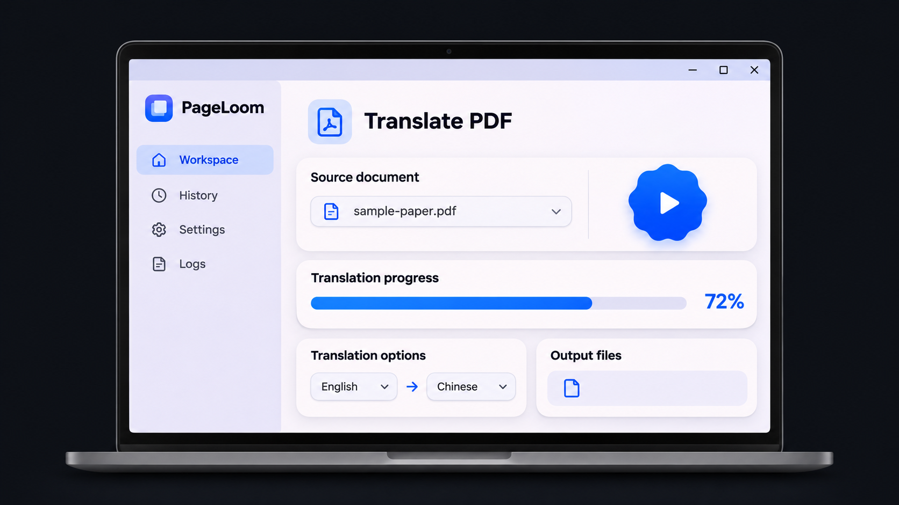
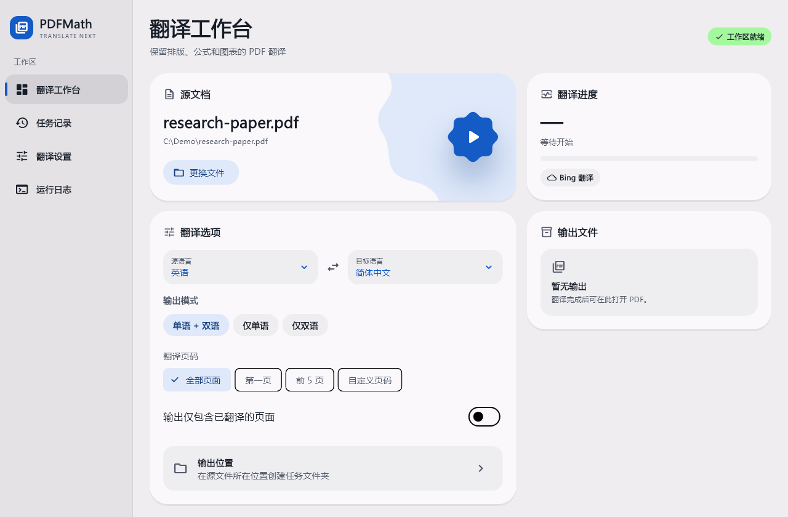
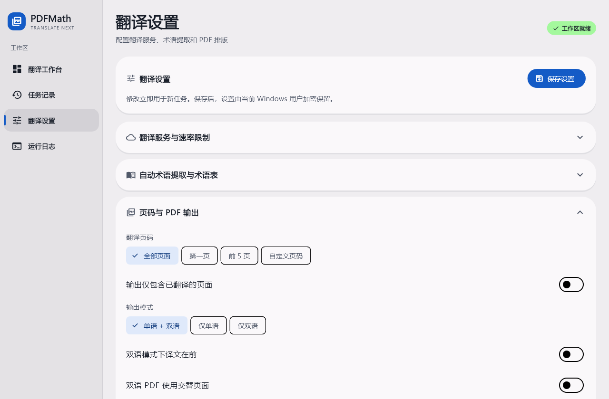
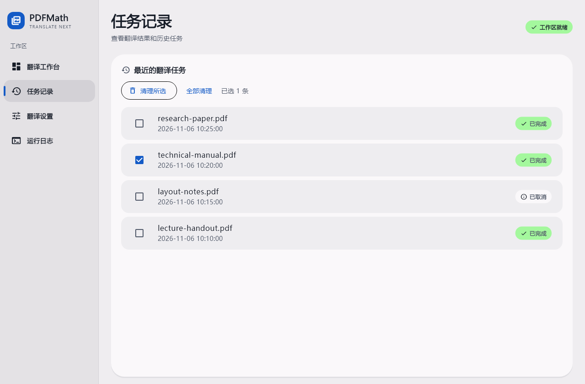

<a href="./README.md">English</a> · <strong>简体中文</strong>

<h1>译页工坊 · PageLoom</h1>

保留排版、公式和图表的 Windows PDF 桌面翻译工具。

<a href="./LICENSE">AGPL-3.0</a> · Windows x64 · Flutter

译页工坊是基于 Flutter 构建的 Windows 桌面应用，使用 PDFMathTranslate-next 和 BabelDOC 翻译学术论文、技术手册及其他排版复杂的 PDF。

  
   
  桌面界面示意图

## 主要功能

- 📄 **保留文档排版。** 保留公式、插图和表格所在的页面布局，支持输出单语或双语 PDF。
- 🌐 **选择翻译服务。** 支持 Bing、Google、OpenAI 兼容接口、Ollama 等服务。
- 🎛️ **配置翻译范围和输出。** 支持自定义页码、PDF 输出和高级排版选项，可导入 CSV 术语表或自动提取术语。
- 📊 **查看任务进度。** 查看实时进度和引擎日志，从本机任务记录打开已生成的文件。

## 界面截图

以下截图使用示例文档和任务展示 Flutter 界面。

### 翻译工作台

### 翻译设置

### 任务记录

## 安装与使用

### 安装

1. 在 [Releases](https://github.com/XilinGuo/PageLoom/releases) 页面下载 **Windows x64 ZIP**。
2. 完整解压 ZIP。移动程序时请将启动文件和同目录的依赖一起移动。
3. 双击 `PDFMathTranslate.exe`，这是当前构建的启动文件名。

下载包内含所需的运行时、翻译引擎、排版模型和字体。在线翻译服务需要联网，部分服务需要 API Key 或单独运行的服务。

### 使用

1. 在「翻译工作台」选择 PDF。
2. 选择源语言、目标语言和 PDF 输出模式。
3. 如需更换服务、添加术语表或调整高级选项，打开「翻译设置」。
4. 点击蓝色播放按钮。翻译完成后，在工作台打开输出 PDF 或目录。

## 从源码构建

构建环境和打包命令见 [Windows 打包说明](./desktop/README.md#from-source)。

| 路径 | 用途 |
| --- | --- |
| [`desktop/lib/`](./desktop/lib/) | Flutter 桌面界面 |
| [`desktop/windows/`](./desktop/windows/) | Windows 启动器及系统接口 |
| [`desktop/backend/bridge.py`](./desktop/backend/bridge.py) | 接收翻译请求并返回进度和结果的本地 Python 桥接 |
| [`pdf2zh_next/`](./pdf2zh_next/) | PDFMathTranslate-next 翻译引擎和 Web 界面 |

## 致谢与许可证

译页工坊基于 [PDFMathTranslate-next](https://github.com/PDFMathTranslate-next/PDFMathTranslate-next) 和 [BabelDOC](https://github.com/funstory-ai/BabelDOC)，桌面界面使用 [Flutter](https://flutter.dev/) 开发。

项目采用 [GNU Affero 通用公共许可证 v3.0](./LICENSE)。
